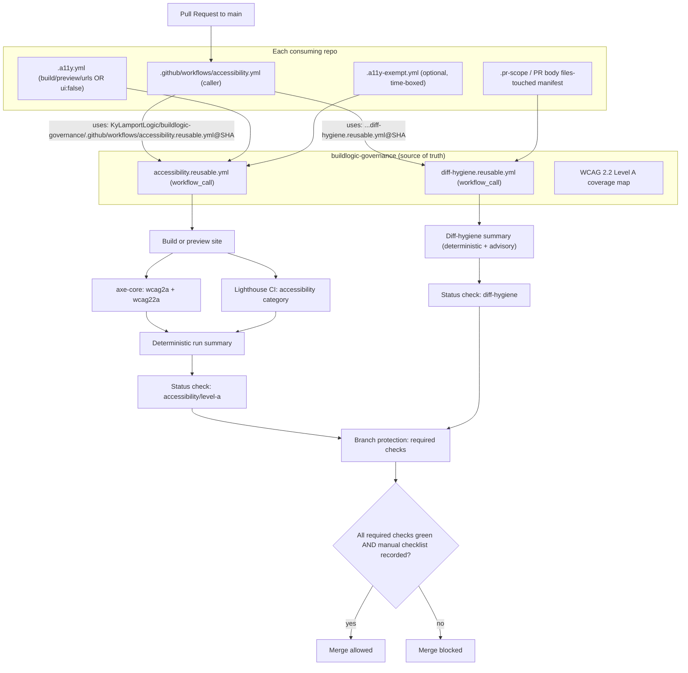

<!--
Home repo: KyLamportLogic/buildlogic-governance. Authored spec artifact; human approves before implementation.
All third-party Actions below shown as @<pinned-sha> placeholders — implementer MUST pin to immutable commit SHAs
(repo governance). All workflows declare minimal explicit permissions.
-->

# Accessibility Enforcement System — Design

Implements `requirements.md`. Follows the reusable-workflow precedent of `specs/codebase-snapshot-sync` (UNVERIFIED-1).

## Architecture



## Reusable accessibility workflow (shape; versions/SHAs pinned by implementer)

```yaml
# buildlogic-governance/.github/workflows/accessibility.reusable.yml
name: accessibility-level-a
on:
  workflow_call:
    inputs:
      config-path: { type: string, default: ".a11y.yml" }
permissions:
  contents: read
  checks: write
  pull-requests: write   # summary comment only
jobs:
  a11y:
    runs-on: ubuntu-latest
    steps:
      - uses: actions/checkout@<pinned-sha>
      - name: Parse config / exemptions / ui:false     # REQ-F2 fail if undeclared; REQ-E2 fail if expired
      - uses: actions/setup-node@<pinned-sha>          # only if ui:true
        with: { node-version: "22.23.2" }
      - name: Build & start preview                    # from .a11y.yml build/preview/wait_on
      - name: Run axe-core (wcag2a,wcag22a)            # REQ-B1 fail if critical|serious > 0
      - name: Run Lighthouse CI (accessibility)         # REQ-B3 fail if score < 0.95
      - name: Emit summary + manual-checklist notice    # REQ-B4 / REQ-I3
```

## Thin per-repo caller

```yaml
# <repo>/.github/workflows/accessibility.yml
name: Accessibility
on:
  pull_request:
    branches: [main]
permissions:
  contents: read
  checks: write
  pull-requests: write
jobs:
  level-a:
    uses: KyLamportLogic/buildlogic-governance/.github/workflows/accessibility.reusable.yml@<pinned-sha>
  diff-hygiene:
    uses: KyLamportLogic/buildlogic-governance/.github/workflows/diff-hygiene.reusable.yml@<pinned-sha>
```

## Threshold justification
- **axe-core critical/serious = 0 (hard gate):** axe-core maps each rule to specific WCAG success criteria with near-zero false positives at these impact levels — the deterministic core of the gate.
- **Lighthouse accessibility ≥ 0.95 (secondary signal):** Lighthouse bundles a weighted subset of axe audits. A perfect `1.0` is brittle against dynamic/async content and would create flaky gates; `<0.90` lets real regressions through. `0.95` catches regressions without rewarding flakiness. axe remains the binary authority; Lighthouse is corroboration (REQ-B5).

## WCAG 2.2 Level A — automation coverage (REQ-C1)

| SC (Level A) | Short name | Classification |
|---|---|---|
| 1.1.1 | Non-text content | automated (alt presence) / manual-only (meaningfulness) |
| 1.2.1 | Audio-only & video-only (prerecorded) | manual-only |
| 1.3.1 | Info & relationships (semantics) | partial |
| 1.3.2 | Meaningful sequence | partial |
| 1.3.3 | Sensory characteristics | manual-only |
| 1.4.1 | Use of color | partial |
| 1.4.2 | Audio control | manual-only |
| 2.1.1 | Keyboard | partial (axe detects some; full = manual) |
| 2.1.2 | No keyboard trap | manual-only |
| 2.1.4 | Character key shortcuts | manual-only |
| 2.2.1 | Timing adjustable | manual-only |
| 2.2.2 | Pause, stop, hide | manual-only |
| 2.3.1 | Three flashes or below threshold | manual-only |
| 2.4.1 | Bypass blocks (skip link / landmarks) | automated |
| 2.4.2 | Page titled | automated |
| 2.4.3 | Focus order | partial / manual-only |
| 2.4.4 | Link purpose (in context) | partial |
| 2.5.1 | Pointer gestures | manual-only |
| 2.5.2 | Pointer cancellation | manual-only |
| 2.5.3 | Label in name | partial |
| 2.5.4 | Motion actuation | manual-only |
| 2.5.7 | Dragging movements (2.2) | manual-only |
| 2.5.8 | Target size minimum (2.2) | partial (geometry) |
| 3.1.1 | Language of page | automated |
| 3.2.1 | On focus | manual-only |
| 3.2.2 | On input | manual-only |
| 3.2.6 | Consistent help (2.2) | manual-only |
| 3.3.1 | Error identification | partial |
| 3.3.2 | Labels or instructions | automated (label presence) |
| 3.3.7 | Redundant entry (2.2) | manual-only |
| 4.1.2 | Name, role, value | automated |

> Rule: `partial` and `manual-only` SCs are **never** reported as conformant from automation alone (REQ-C2); they route to the manual checklist (REQ-C3).

## Per-repo config format (`.a11y.yml`)

```yaml
# UI repo
ui: true
build: "npm ci && npm run build"
preview: "npx serve -s dist -l 4321"
wait_on: "http://localhost:4321"
urls:
  - "http://localhost:4321/"
  - "http://localhost:4321/about"
```
```yaml
# No-UI repo (REQ-F1)
ui: false
rationale: "Shell automation library; serves no web interface."
```

## Exemption format (`.a11y-exempt.yml`)

```yaml
exemptions:
  - scope: "http://localhost:4321/legacy-report"
    reason: "Third-party embedded iframe; remediation tracked in ISSUE-123"
    approver: "Ky"
    created: "2026-10-14"
    expires: "2026-12-01"   # past date => check FAILS (REQ-E2); never silent
```

## Rollout strategy without breaking in-flight PRs (REQ-D3/REQ-D4)
1. Add caller workflow in **grace mode** (branch protection does not yet require it). It reports but cannot block.
2. Remediate `main` until the automated check is green on `main`.
3. Confirm the check name has reported at least once (REQ-D4), then enable branch protection requiring `accessibility/level-a` (and `diff-hygiene`) → **enforce mode**.
4. In-flight PRs rebased after step 3 pick up the requirement; none are retroactively failed before `main` is green.

## Conflict resolution (REQ-J2)
- The system runs as its own workflow files (`accessibility.yml` caller; reusable workflows in governance) and its own status check names (`accessibility/level-a`, `diff-hygiene`). It never edits existing workflows and never weakens existing CI.
- IF a repo already has an accessibility job, the existing job is left intact; the required status check is the new shared one. The old job may be retired later by the human, out of band — the gate does not depend on it.

## Diff-Hygiene Gate design (group K)

Enforces the minimal-diff discipline (group H.2). Two classes of output, clearly labeled (REQ-K5):

**Deterministic (block merge):**
- Lint/format: ESLint (incl. `eslint-plugin-jsx-a11y` for UI repos) and Prettier/format check must pass (REQ-K2). Runs additively; if a repo has no config, the reusable workflow supplies a baseline config scoped to changed files only.
- New-dependency guard: fail if `package.json`/lockfile adds a runtime dependency not referenced in the PR's files-touched manifest or spec (REQ-K2).
- Stray-file guard: fail on `*.log`, `*.tmp`, `debug*`, `scratch*`, editor swap files, or committed `node_modules` (REQ-K2).
- Scope guard: fail if the PR modifies files outside the declared files-touched manifest (`.pr-scope` file or a `## Files touched` section in the PR body), making REQ-H6 machine-checkable (REQ-K3).

**Advisory (reviewer judgment, posted not blocking):**
- Heuristic flags for likely-unrequested abstractions, unusually large hunks, or hunks lacking an obvious spec mapping (REQ-K4). The human reviewer uses these to enforce REQ-H7 and REQ-H9 (a PR that adds unrequested scope fails review even with green tests).

```yaml
# buildlogic-governance/.github/workflows/diff-hygiene.reusable.yml
name: diff-hygiene
on: { workflow_call: {} }
permissions:
  contents: read
  pull-requests: write   # advisory comment only
jobs:
  hygiene:
    runs-on: ubuntu-latest
    steps:
      - uses: actions/checkout@<pinned-sha>
        with: { fetch-depth: 0 }   # need base..head diff
      - name: Compute changed files (base..head)
      - name: Deterministic — lint/format on changed files     # block (REQ-K2)
      - name: Deterministic — new-dependency guard             # block (REQ-K2)
      - name: Deterministic — stray-file guard                 # block (REQ-K2)
      - name: Deterministic — scope-manifest guard             # block (REQ-K3)
      - name: Advisory — heuristic scope/abstraction flags     # comment only (REQ-K4)
      - name: Emit summary labeling block vs advisory          # REQ-K5
```

## Spec Template Block (paste into future UI specs — REQ-G)

```markdown
### Accessibility Acceptance Criteria (WCAG 2.2 Level A — required before implementation)
- [ ] axe-core reports 0 critical and 0 serious violations (tags wcag2a, wcag22a) on all listed URLs.
- [ ] Lighthouse accessibility score >= 0.95 on all listed URLs.
- [ ] Every interactive element is reachable and operable by keyboard alone (Tab/Shift-Tab/Enter/Space/Esc), with a visible focus indicator.
- [ ] All form inputs are programmatically labeled.
- [ ] Document language is declared; all non-text content has a text alternative.
- [ ] Manual checklist (keyboard-only + screen-reader spot-check) recorded in PR. Automated pass alone does NOT satisfy this.
```

## Agent Instruction Block (REQ-H)

```markdown
When generating UI, you MUST:
- Use real semantic elements (<button>, <a href>, <nav>, <main>, ordered headings). No clickable <div>/<span>.
- Label every input (<label for> / aria-label / aria-labelledby).
- Add ARIA only to fill gaps native HTML cannot; never duplicate native roles.
- Manage focus for dynamic UI (trap focus in modals, restore on close, visible focus ring).
- Set <html lang>; provide alt text that conveys purpose (empty alt="" only for decorative images).

Minimal-diff discipline (non-negotiable):
- List the files you will create/modify BEFORE writing code; modify only those files.
- Every hunk must be justifiable against the spec. No new abstractions, dependencies, or unrelated refactors unless the spec asks for them.
- Leave no stray files (debug scripts, scratch notes, commented-out code, logs).
- A PR that adds unrequested scope fails review even if all tests pass.
```

## Manual Verification Checklist (REQ-I)

**Keyboard-only pass:** Unplug/disable the mouse. Tab through the entire page. Confirm: every interactive control is reachable in a logical order; focus is always visible; no keyboard trap; Enter/Space activate controls; Esc closes overlays; any skip-link works and lands correctly.

**Screen-reader spot-check (VoiceOver on macOS / NVDA on Windows):** Navigate by headings and landmarks. Confirm: images announce meaningful alt text (or are silent if decorative); form fields announce their label and state; buttons announce as buttons with a clear purpose; dynamic updates (toasts, modal open/close) are announced.

**Recording:** Check the boxes in the PR body (or link an artifact). Required for any UI-changing PR. A green automated check with no recorded manual checklist is labeled **partial**, never complete (REQ-I3).

## Least-privilege permissions (REQ-J1)

```yaml
permissions:
  contents: read
  checks: write
  pull-requests: write   # summary/advisory comment only
```
No new secrets; default `GITHUB_TOKEN` scope only. All third-party Actions pinned to immutable commit SHAs (repo governance).

## Changelog
- 2026-10-14 — Initial design authored, including diff-hygiene gate design (deterministic vs. advisory), minimal-diff agent block, WCAG 2.2 Level A coverage table, and SHA-pinned/minimal-permission workflow shapes.
